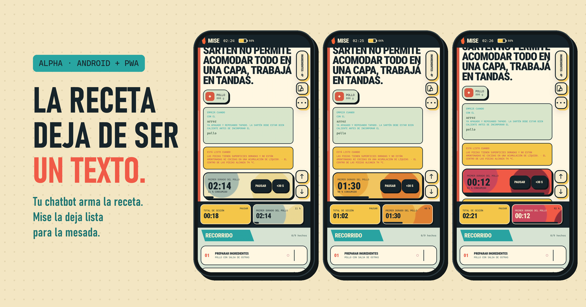
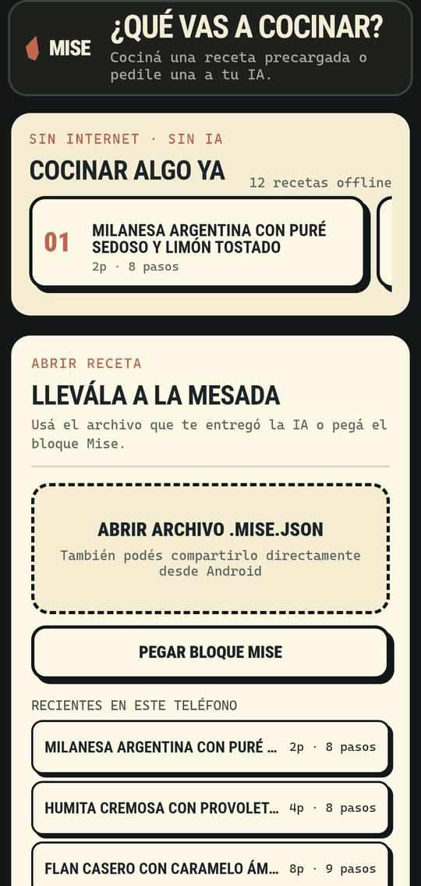
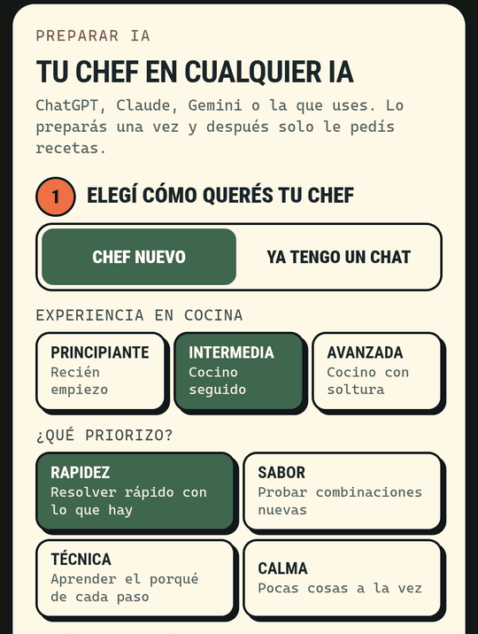
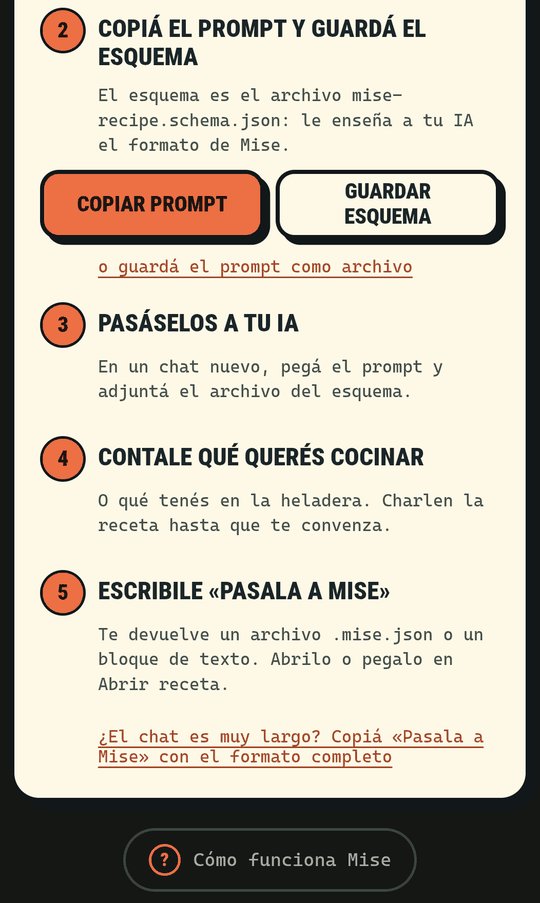
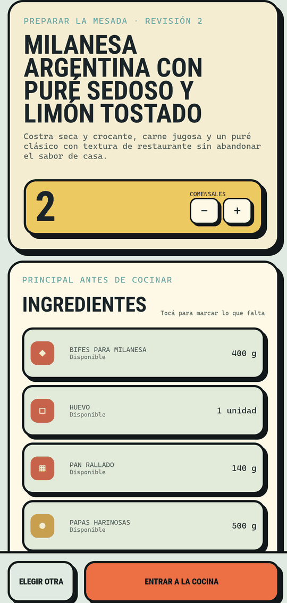
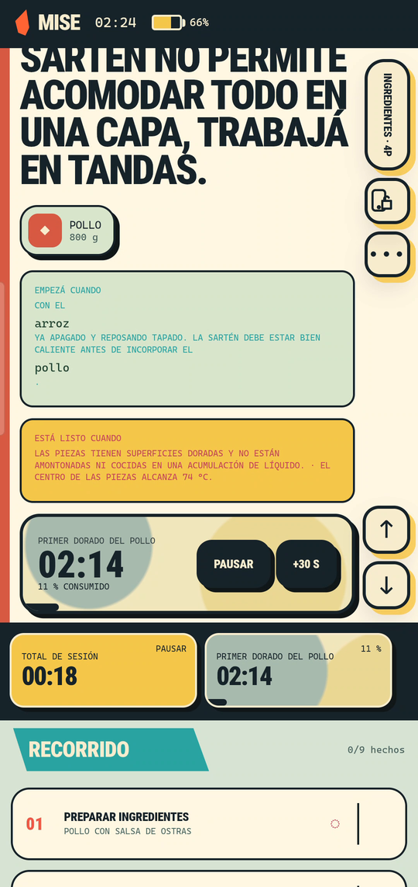
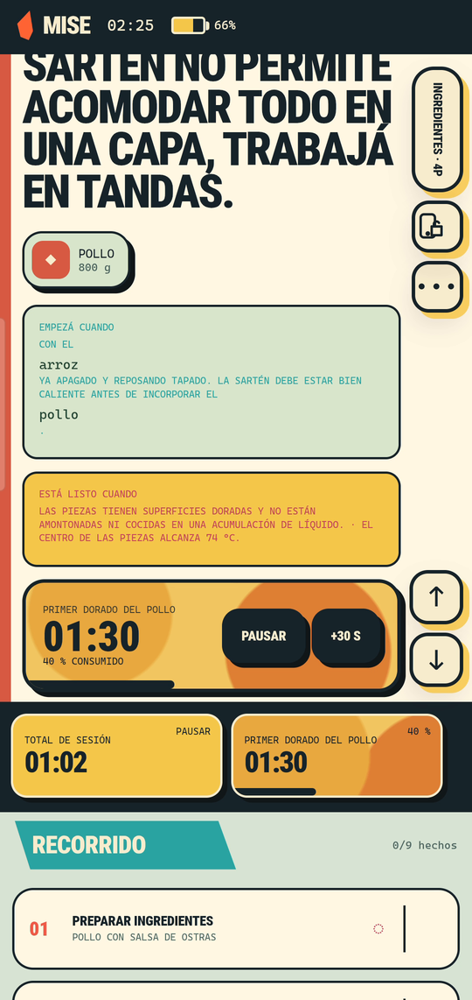
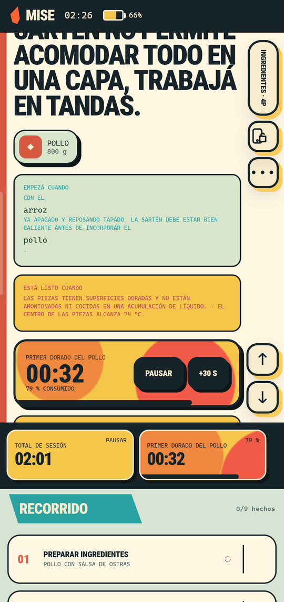
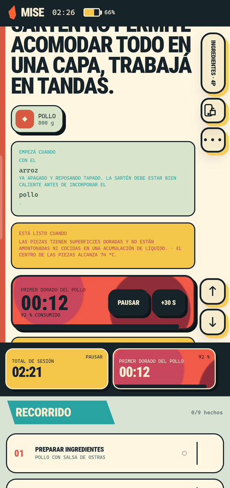
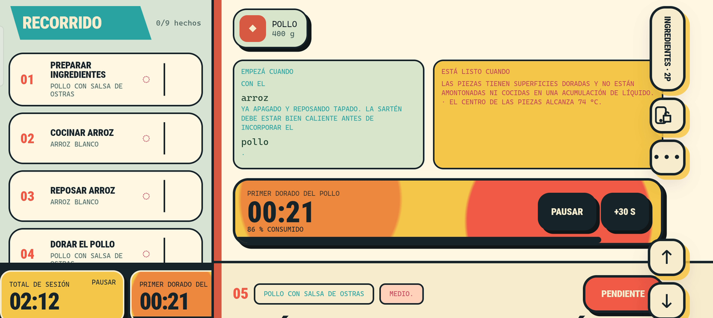

<div align="center">
  
  <h1>Mise Cocina</h1>
  <p><strong>La receta deja de ser un texto y se convierte en una mesa de trabajo.</strong></p>
  <p>Aplicación local, con código fuente público, para cocinar las recetas que armás con tu chatbot. Sin cuenta, sin servidor y sin API key.</p>

  [](ROADMAP.md)
  [](LICENSE)
  [](docs/ANDROID.md)
  [](https://github.com/PullAngel/mise-cocina/releases/latest)
</div>

## Descargar para Android

<div align="center">

[](https://github.com/PullAngel/mise-cocina/releases/latest)

</div>

1. Tocá el botón. En la página que se abre, bajá el archivo que termina en `.apk` (está en la lista **Assets**, debajo de las novedades).
2. Abrí el archivo descargado. Android te va a pedir permiso para instalar apps desde el navegador o desde el administrador de archivos: permitilo.
3. Abrí Mise. La primera vez, un tutorial te muestra dónde está cada cosa.

Es una versión **alpha** para pruebas. Android puede avisarte que la app viene de una fuente externa: es normal fuera de Google Play. Verificá que la descargaste desde este repositorio, `PullAngel/mise-cocina`. Al instalar una versión nueva sobre la anterior se conservan tus recetas, salvo que Android pida desinstalar la anterior por un cambio de firma.



## Qué es

Mise recibe una receta en formato `.mise.json` y la transforma en una superficie continua para cocinar. La receta puede prepararse con ChatGPT, Claude, Gemini u otra IA usando el esquema y los prompts incluidos, pero la aplicación funciona completamente en el teléfono: no exige cuenta, servidor, API key ni conexión durante la cocina.

- **Receta completa y desplazamiento libre.** No obliga a confirmar tarjetas para avanzar.
- **Ingredientes conectados al flujo.** Escala porciones, marca faltantes y muestra dónde se usa cada ingrediente.
- **Temporizadores recuperables.** Se basan en una hora de vencimiento y sobreviven a cambios de aplicación o reinicios. Sus círculos cambian de tono con el avance: calma, activo, alerta y crítico.
- **Señales para cocinar mejor.** Cada paso puede explicar cuándo empezar, cómo reconocer el punto y cómo rescatar un error.
- **Interfaz para la mesada.** Tipografía visible, zonas táctiles grandes, rotación automática y bloqueo propio.
- **Tu Chef a medida.** Tres preguntas (experiencia en cocina, qué priorizar y cuánto guiar) arman el prompt para tu IA entre 36 combinaciones.
- **Tutorial de primera vez.** Resaltes sobre la pantalla real, saltables y repetibles desde «Cómo funciona Mise».
- **Privacidad local.** Las recetas y el estado permanecen en el dispositivo.

## Para quién es

Mise está pensada para quien **ya usa una IA para decidir qué cocinar**: le cuenta qué tiene en casa, cuánto tiempo hay y qué quiere aprender, y quiere seguir esa receta en la cocina sin volver a leer un chat largo con las manos ocupadas.

No es un recetario con buscador ni con fotos, y no genera recetas por sí sola: la conversación ocurre antes, en tu chatbot, y Mise se ocupa del resto.

## Así se ve

Capturas reales tomadas en un Samsung Galaxy A55.

<table>
  <tr>
    <td align="center" width="25%"><br><sub><b>Inicio</b><br>Cocinar algo ya, o abrir la receta que te dio la IA.</sub></td>
    <td align="center" width="25%"><br><sub><b>Preparar IA · paso 1</b><br>Tres respuestas arman tu Chef.</sub></td>
    <td align="center" width="25%"><br><sub><b>Preparar IA · pasos 2 a 5</b><br>Del prompt al archivo <code>.mise.json</code>.</sub></td>
    <td align="center" width="25%"><br><sub><b>Preparar la mesada</b><br>Porciones e ingredientes antes de empezar.</sub></td>
  </tr>
</table>

### Cocinar: los círculos del temporizador cambian de tono

<table>
  <tr>
    <td align="center" width="25%"><br><sub><b>Calma</b><br>Arranca el paso.</sub></td>
    <td align="center" width="25%"><br><sub><b>Activo</b><br>El paso va avanzando.</sub></td>
    <td align="center" width="25%"><br><sub><b>Alerta</b><br>Se acerca el final.</sub></td>
    <td align="center" width="25%"><br><sub><b>Crítico</b><br>Hay que mirar la olla.</sub></td>
  </tr>
</table>

### Cocinar en horizontal

La interfaz se reacomoda sola cuando girás el teléfono: recorrido a la izquierda, paso actual y temporizador a la derecha.

<div align="center">
  
</div>

## Probar Mise

1. Descargá el [APK más reciente](https://github.com/PullAngel/mise-cocina/releases/latest) e instalalo (Android puede pedirte permiso para instalar desde el navegador).
2. La primera vez, un tutorial te muestra dónde está cada cosa. Podés saltarlo y repetirlo con «Cómo funciona Mise», al final del inicio.
3. Probá una de las recetas precargadas en **Cocinar algo ya**; funcionan sin internet.
4. Para tus propias recetas, usá **Preparar IA**:
   1. Respondé cómo querés tu Chef: experiencia en cocina, qué priorizar y cuánto guiar.
   2. Copiá el prompt y guardá el esquema `mise-recipe.schema.json`.
   3. Pegá el prompt en tu chat de ChatGPT, Claude, Gemini u otra IA y adjuntá el esquema.
   4. Contale qué querés cocinar o qué tenés en la heladera.
   5. Pedile «Pasala a Mise» y abrí el archivo `.mise.json` (o pegá el bloque) en **Abrir receta**.

Los detalles del prompt están en el [kit de prompts](docs/PROMPT_KIT.md) y el formato en el [JSON Schema](schema/mise-recipe.schema.json).

Mise está en **alpha**: sirve para pruebas cotidianas, pero todavía no es una publicación de tienda ni promete compatibilidad con todos los fabricantes Android.

## Desarrollo

Requiere Node.js 20.19 o superior y pnpm.

```bash
pnpm install
pnpm dev
```

Comprobaciones principales:

```bash
pnpm test
pnpm run build
pnpm run android:sync
```

La aplicación web usa React, TypeScript y Vite. Capacitor empaqueta la misma experiencia para Android y agrega notificaciones, orientación, importación de archivos, estado del dispositivo y síntesis de voz.

## Formato público

El contrato canónico es `mise.recipe` 1.2. Las recetas incluidas, el esquema y los prompts son parte del repositorio para que otras personas puedan estudiarlos y crear importadores, validadores, editores o interfaces compatibles **sin fines comerciales** (ver [Licencia y colaboración](#licencia-y-colaboración)).

- [Especificación y requisitos](docs/PRODUCT_REQUIREMENTS.md)
- [Arquitectura](docs/ARCHITECTURE.md)
- [Mapa completo de documentación](docs/README.md)
- [Ficha pública del producto](docs/PRODUCT_BRIEF.md)
- [Roadmap](ROADMAP.md)
- [Historial de versiones](CHANGELOG.md)

## Licencia y colaboración

* Código fuente público. Podés leerlo, estudiarlo, modificarlo y compartir tus versiones bajo condiciones no comerciales, según la [PolyForm Noncommercial License 1.0.0](https://github.com/PullAngel/mise-cocina/blob/main/LICENSE).
* La explotación comercial está reservada al titular del proyecto, salvo autorización expresa.
* Contribuciones: son bienvenidas y requieren aceptar un [CLA](https://github.com/PullAngel/mise-cocina/blob/main/CLA.md). Las instrucciones están en [CONTRIBUTING.md](https://github.com/PullAngel/mise-cocina/blob/main/CONTRIBUTING.md).
