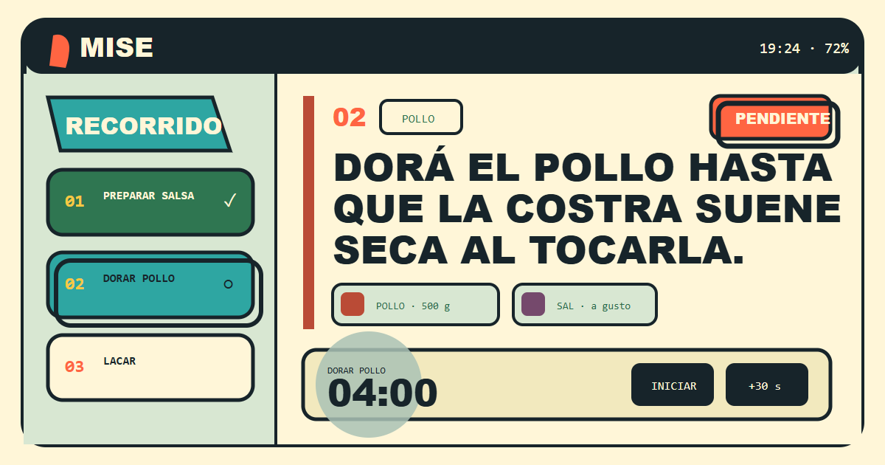

<div align="center">
  
  <h1>Mise Cocina</h1>
  <p><strong>La receta deja de ser un texto y se convierte en una mesa de trabajo.</strong></p>
  <p>Aplicación local y de código abierto para cocinar recetas estructuradas con pasos, ingredientes, señales sensoriales y temporizadores persistentes.</p>

  [](ROADMAP.md)
  [](LICENSE)
  [](docs/ANDROID.md)
  [](https://github.com/PullAngel/mise-cocina/releases/latest)
</div>



## Qué es

Mise recibe una receta en formato `.mise.json` y la transforma en una superficie continua para cocinar. La receta puede prepararse con ChatGPT u otro LLM usando el esquema y los prompts incluidos, pero la aplicación funciona completamente en el teléfono: no exige cuenta, servidor, API key ni conexión durante la cocina.

- **Receta completa y desplazamiento libre.** No obliga a confirmar tarjetas para avanzar.
- **Ingredientes conectados al flujo.** Escala porciones, marca faltantes y muestra dónde se usa cada ingrediente.
- **Temporizadores recuperables.** Se basan en una hora de vencimiento y sobreviven a cambios de aplicación o reinicios.
- **Señales para cocinar mejor.** Cada paso puede explicar cuándo empezar, cómo reconocer el punto y cómo rescatar un error.
- **Interfaz para la mesada.** Tipografía visible, zonas táctiles grandes, rotación automática y bloqueo propio.
- **Privacidad local.** Las recetas y el estado permanecen en el dispositivo.

## Probar Mise

1. Descargá el [APK más reciente](https://github.com/PullAngel/mise-cocina/releases/latest).
2. Abrí una de las recetas precargadas o importá un archivo `.mise.json`.
3. Para preparar una receta con un asistente, usá el [kit de prompts](docs/PROMPT_KIT.md) junto con el [JSON Schema](schema/mise-recipe.schema.json).

Mise está en **alpha**: sirve para pruebas cotidianas, pero todavía no es una publicación de tienda ni promete compatibilidad con todos los fabricantes Android.

## Desarrollo

Requiere Node.js 20.19 o superior y pnpm.

```bash
pnpm install
pnpm dev
```

Comprobaciones principales:

```bash
pnpm test
pnpm run build
pnpm run android:sync
```

La aplicación web usa React, TypeScript y Vite. Capacitor empaqueta la misma experiencia para Android y agrega notificaciones, orientación, importación de archivos, estado del dispositivo y síntesis de voz.

## Formato abierto

El contrato canónico es `mise.recipe` 1.2. Las recetas incluidas, el esquema y los prompts son parte del repositorio para que otras personas puedan crear importadores, validadores, editores o interfaces compatibles.

- [Especificación y requisitos](docs/PRODUCT_REQUIREMENTS.md)
- [Arquitectura](docs/ARCHITECTURE.md)
- [Mapa completo de documentación](docs/README.md)
- [Ficha pública del producto](docs/PRODUCT_BRIEF.md)
- [Roadmap](ROADMAP.md)
- [Historial de versiones](CHANGELOG.md)

## Contribuir

Las contribuciones son bienvenidas, desde una receta mejor explicada hasta correcciones de accesibilidad, Android o diseño. Antes de empezar, leé [CONTRIBUTING.md](CONTRIBUTING.md). Los cambios de comportamiento deben respetar los documentos de producto y acompañarse con una verificación proporcional al riesgo.

## Licencia y marca

El código se distribuye bajo **GPL-3.0-or-later**. Podés usarlo, estudiarlo, modificarlo y distribuirlo; las versiones derivadas distribuidas deben conservar las libertades de la licencia. La licencia permite actividad comercial. El nombre y la identidad visual se rigen además por [TRADEMARKS.md](TRADEMARKS.md) para evitar que un fork parezca una versión oficial.

Mise no se presenta como un producto en venta. El proyecto puede sostener en el futuro servicios, soporte, distribución o una edición comercial sin cerrar el núcleo comunitario.
